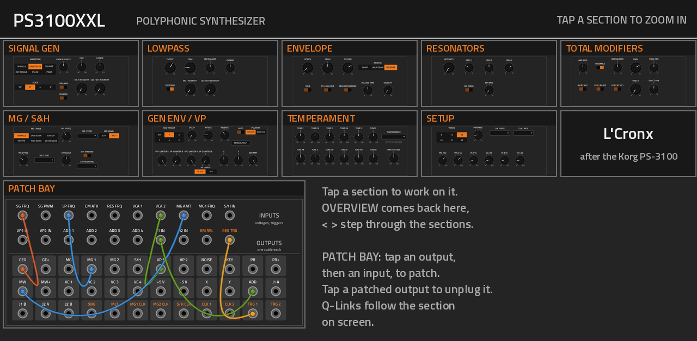
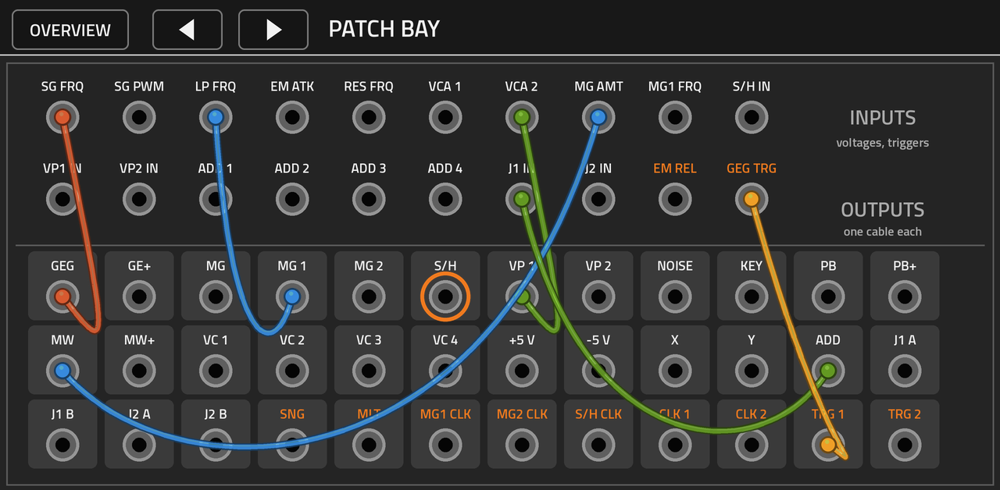

# PS3100XXL v0.1.0

**A Korg PS-3100-style semi-modular polyphonic synthesizer for MPC OS on the Akai Force, with the whole panel on one
zoomable page and a patch bay you patch by touch.**

PS3100XXL is a VST2 instrument for MPC OS's built-in plugin host, made by L'Cronx. It follows the 1977 Korg PS-3100:
one oscillator, filter and envelope per key (up to 48 voices), the three-peak resonators, the ensemble, two
modulation generators, sample & hold, the general envelope, the voltage processors, the twelve temperament knobs and
the patch panel. The sound engine is its own, written from the PS-3100's published architecture and the Full Bucket
FB-3100 manual's description of it; no code from either.

> [!NOTE]
> **Status: 0.1.0, first build, not yet run on a Force.** It passes its own engine tests and the mpc-vst-plugins host
> test on x86 under ASan and UBSan. Everything below about the device is what to check, not what has been seen.

## How it works on the screen

- **Overview:** the whole panel on one page. Each section is a tile showing its controls in miniature, and the patch
  bay shows its live cables. **Tap a tile to zoom into that section.**
- **Zoomed in:** the section fills the screen with large controls. **OVERVIEW** goes back; **<** and **>** step to the
  neighbouring section.
- **Patch bay:** tap an output (it gets an orange ring), then tap an input: a cable is drawn between them. One output
  feeds one input, as on the PS-3100. **Tap a patched output to unplug it.** The line at the top says what you tapped
  and where it goes. A trigger output only goes into a trigger input (orange labels).
- **Q-Links:** the 16 Q-Links follow the section on screen (on the overview: the main sound controls).
- **Presets:** 16 factory sounds in MPC's PRESET menu. A preset changes the controls and keeps your patch.

## Sections

Signal generators (6 waves, 16'-2', fine/coarse, MG 1 and GEG frequency mod with reverse), dynamic lowpass (cutoff,
peak, keyboard balance, expand, mod), envelope modifier (ADS, damp / half damp / release, hold, PS-3100 hold mode,
release override, velocity), resonators (intensity, 3 peaks, MG 2 mod, ext mod), total signal modifiers (amp mod:
cross to ring, ensemble, VCA 1 by GEG, VCA 2 by VP 1, keyboard balance, final and direct with pan), MG 1 (6 waves),
MG 2, S/H (with tempo sync), general envelope (trigger by 1-5 keys, delay, attack, release, auto, polarity, LED), two
voltage processors, X-Y, add amp, manual trigger, temperament (12 knobs + 14 historical templates + master tune),
setup (voices 8-48, pitch bend range, two tempo clocks, MIDI CC triggers and VC 1-4).

Patch bay: 36 outputs (GEG, GE+, MG, MG 1, MG 2, S/H, VP 1, VP 2, noise, key, pitch bend, mod wheel, VC 1-4, +5 V,
-5 V, X, Y, add amp, two junctions with two copies each, and 9 triggers) and 20 inputs. The full list with ranges and
defaults is in [docs/INVENTORY.md](docs/INVENTORY.md), generated from the same file the build checks the skin against.

Left out: the external audio input (an MPC instrument plugin gets no audio input) and Scala file import (no file
picker on MPC).

## Install

Download the zip from Releases and follow its `INSTALL.md` (the installer stops and restarts MPC).

## Build

`./build.sh` (Python 3 with Pillow, a host gcc, Zig: `pip install ziglang`). `test/run_tests.sh` runs the tests.
Everything about the instrument's controls, jacks and views lives in `tools/spec.py`; `tools/gen_params.py` writes the
parameter list, layout and inventory from it, `tools/post_skin.py` draws the panel, knobs, jacks and cables, and
`tools/check_skin.py` fails the build if anything in the inventory is missing from the skin.

Built on [mpc-vst-plugins](https://github.com/sd88me/mpc-vst-plugins). Licence: GPL-3.0-or-later.
Korg and PS-3100 are trademarks of their owners; PS3100XXL is not affiliated with Korg or Full Bucket Music.
